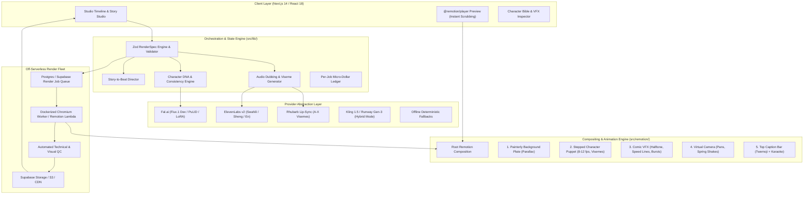

# Comiks X — System Architecture Plan & Phased Roadmap
**Document Version:** 1.0.0  
**Target:** Production-Grade 2D Animated Video Engine  
**Companion File:** `docs/research.md`  

---

## 1. System Architecture Diagram



---

## 2. Core Data Models & Schemas (`RenderSpec`)

All production scenes and timeline compositions are strictly validated using **Zod** schemas. This guarantees determinism, type-safety, and reproducibility across renders.

```typescript
// Conceptual Zod Definition: src/lib/render-engine/schema.ts
import { z } from "zod";

export const VisemeShapeSchema = z.enum([
  "A", // Closed / M, B, P
  "B", // Slightly open / EE, consonants
  "C", // Open / EH, AH
  "D", // Wide open / AA
  "E", // Rounded / O, ER
  "F", // Puckered / OO, W
  "G", // Fricative / F, V
  "H", // Wide / L, TH
  "X", // Idle rest
]);

export const CharacterPoseSchema = z.object({
  poseId: z.string(),
  name: z.string(),
  spriteUrl: z.string().url(),
  mouthAnchor: z.object({ x: z.number(), y: z.number(), scale: z.number().default(1) }),
  eyeAnchor: z.object({ x: z.number(), y: z.number(), scale: z.number().default(1) }),
  handAnchor: z.object({ x: z.number(), y: z.number() }).optional(),
});

export const WordTimestampSchema = z.object({
  word: z.string(),
  startMs: z.number(),
  endMs: z.number(),
  emphasis: z.boolean().default(false),
});

export const DialogueLineSpecSchema = z.object({
  id: z.string(),
  characterId: z.string(),
  text: z.string(),
  language: z.enum(["en", "sw", "sheng"]),
  audioUrl: z.string().url(),
  durationMs: z.number(),
  wordTimestamps: z.array(WordTimestampSchema),
  visemes: z.array(z.object({ timeMs: z.number(), shape: VisemeShapeSchema })),
});

export const CameraKeyframeSchema = z.object({
  frame: z.number(),
  x: z.number().default(0),
  y: z.number().default(0),
  zoom: z.number().default(1.0),
  rotation: z.number().default(0),
  shakeIntensity: z.number().default(0),
});

export const CartoonVFXSchema = z.object({
  type: z.enum(["speed_lines", "impact_frame", "halftone_dots", "smear", "sound_burst"]),
  startFrame: z.number(),
  durationFrames: z.number(),
  text: z.string().optional(), // For sound bursts e.g. "BAM!", "HEH?!"
  intensity: z.number().default(1.0),
});

export const SceneSpecSchema = z.object({
  sceneId: z.string(),
  sceneIndex: z.number(),
  durationFrames: z.number(), // At target FPS (e.g., 30)
  productionMode: z.enum(["limited_animation", "rigged_puppet", "ai_hybrid", "motion_comic"]),
  background: z.object({
    plateUrl: z.string().url(),
    parallaxDepth: z.number().default(0),
    tintHex: z.string().optional(),
  }),
  characters: z.array(z.object({
    characterId: z.string(),
    xPercent: z.number(), // 0 to 100
    yPercent: z.number(),
    scale: z.number().default(1.0),
    flipHorizontal: z.boolean().default(false),
    poseTimeline: z.array(z.object({ frame: z.number(), poseId: z.string() })),
    activeDialogueId: z.string().optional(),
  })),
  dialogues: z.array(DialogueLineSpecSchema),
  vfx: z.array(CartoonVFXSchema).default([]),
  camera: z.array(CameraKeyframeSchema).default([]),
  fpsRetiming: z.number().default(12), // 12fps (on-twos) or 8fps (on-threes)
});

export const TopCaptionBarSpecSchema = z.object({
  enabled: z.boolean().default(true),
  headlineText: z.string(), // E.g. "That one church close to your house ⛪😂"
  positionYPercent: z.number().default(9), // Top third
  fontFamily: z.string().default("Cabinet Grotesk"),
  fontWeight: z.string().default("900"),
  backgroundColor: z.string().default("rgba(255, 255, 255, 0.96)"),
  textColor: z.string().default("#111827"),
  activeWordHighlightColor: z.string().default("#10B981"),
  karaokeMode: z.boolean().default(true),
});

export const EpisodeRenderSpecSchema = z.object({
  episodeId: z.string(),
  title: z.string(),
  aspectRatio: z.enum(["9:16", "16:9"]),
  width: z.number(),
  height: z.number(),
  fps: z.number().default(30),
  seed: z.number(),
  captionBar: TopCaptionBarSpecSchema,
  scenes: z.array(SceneSpecSchema),
  audioMastering: z.object({
    targetLUFS: z.number().default(-14),
    musicBedUrl: z.string().url().optional(),
    musicBedVolume: z.number().default(0.12),
    duckingDb: z.number().default(-18),
  }),
});

export type EpisodeRenderSpec = z.infer<typeof EpisodeRenderSpecSchema>;
```

---

## 3. Remotion Composition Stack Architecture

Every video rendered in Comiks X passes through the unified component tree in `src/remotion/`:

```
<EpisodeComposition spec={spec}>
  ├── <AudioMasterTrack spec={spec} />         // Music bed (-18dB ducking) + Foley stems
  ├── <SeriesWatermark brand={spec.brand} />    // Discreet platform branding
  │
  └── <TransitionSeries>                       // Precise editorial cuts / halftone wipes
        {spec.scenes.map(scene => (
          <TransitionSeries.Sequence durationInFrames={scene.durationFrames}>
            <SceneCameraWrapper camera={scene.camera}>
              {/* Layer 1: Background Plate with Parallax */}
              <BackgroundPlateLayer bg={scene.background} />
              
              {/* Layer 2: Characters (Quantized to 8–12 fps) */}
              <SteppedRateContainer fps={scene.fpsRetiming}>
                {scene.characters.map(char => (
                  <CharacterPuppetLayer 
                    character={char} 
                    dialogues={scene.dialogues} 
                  />
                ))}
              </SteppedRateContainer>
              
              {/* Layer 3: Dynamic 2D Cartoon VFX */}
              <CartoonVFXLayer vfx={scene.vfx} />
            </SceneCameraWrapper>
          </TransitionSeries.Sequence>
        ))}
      </TransitionSeries>
  │
  └── <TopCaptionBarLayer caption={spec.captionBar} scenes={spec.scenes} /> // Stays anchored on top
  └── <PlatformSafeZoneOverlay active={isDebug} />
</EpisodeComposition>
```

---

## 4. Comprehensive Phased Roadmap & File-Level Change List

### Phase 1: Production Modes Engine
* **Goal:** Enable 4 distinct production modes (Limited Animation, Rigged Puppet, AI Motion Hybrid, Motion Comic) selectable per episode and per scene.
* **Files to Create / Modify:**
  * `src/lib/render-engine/schema.ts` — Comprehensive Zod schema defining `EpisodeRenderSpec`, `SceneSpec`, `CharacterPose`, `VisemeShape`.
  * `src/lib/render-engine/modes/limited-animation.ts` — Stepped frame quantization and sprite-swap logic.
  * `src/lib/render-engine/modes/rigged-puppet.ts` — SVG/cutout joint hierarchy and spring dynamics.
  * `src/lib/render-engine/modes/ai-motion-hybrid.ts` — I2V video ingestion with anime decimation filter.
  * `src/lib/render-engine/modes/motion-comic.ts` — Multi-panel layout, gutter styling, and halftone wipes.
  * `src/lib/render-engine/index.ts` — Unified pipeline facade.

### Phase 2: Consistency Engine & Character Bible
* **Goal:** Enforce rock-solid character design continuity across shots without drift.
* **Files to Create / Modify:**
  * `src/lib/character-os/character-bible.ts` — Orthogonal turnaround pack (front, 3/4, side, back) and color hex palette locks.
  * `src/lib/character-os/face-embed-validator.ts` — Cosine similarity check between rendered frames and character anchor.
  * `src/lib/character-os/matting-service.ts` — Background extraction with BiRefNet integration and edge halo cleanup.
  * `src/lib/character-os/index.ts` — Export updated character consistency APIs.

### Phase 3: Story to Screen (Story Studio & Animatic Generator)
* **Goal:** Convert narrative ideas into structured beat sheets and fast 2D animatics before final rendering.
* **Files to Create / Modify:**
  * `src/lib/story-studio/beat-generator.ts` — Structured 3-act / comedy short beat sheet builder.
  * `src/lib/story-studio/animatic-generator.ts` — Generates rapid, low-res preview storyboard video in seconds.
  * `src/lib/story-studio/dialogue-timing.ts` — Calculates speech cadence and scene durations.

### Phase 4: Virtual Camera, Cartoon VFX & Look Presets
* **Goal:** Bring cinematic visual punch and authentic 2D cartoon physics into Remotion.
* **Files to Create / Modify:**
  * `src/remotion/vfx/SpeedLines.tsx` — Dynamic radial/linear manga and cartoon speed lines.
  * `src/remotion/vfx/ImpactFrame.tsx` — 1-to-2 frame inverted B&W color shockwaves.
  * `src/remotion/vfx/HalftoneOverlay.tsx` — Retro comic book benday dot shader.
  * `src/remotion/vfx/SoundBurst.tsx` — Comic sound bubbles ("POW!", "HA!", "AYI!") with pop springs.
  * `src/remotion/camera/VirtualCamera.tsx` — Spring-based camera shake, zoom punch, and smooth pans.

### Phase 5: Audio Engine, Multilingual Dubbing & -14 LUFS Mastering
* **Goal:** Broadcast-grade audio pipeline with authentic Swahili, Sheng, and English dialogue and auto-ducking.
* **Files to Create / Modify:**
  * `src/lib/audio-studio/sheng-dictionary.ts` — Phonetic dictionary for Nairobi street slang.
  * `src/lib/audio-studio/viseme-extractor.ts` — Rhubarb phoneme-to-viseme extraction wrapper.
  * `src/lib/audio-studio/audio-masterer.ts` — -14 LUFS loudness normalization and dynamic music ducking.
  * `src/lib/audio-studio/stem-exporter.ts` — Exports isolated dialogue, SFX, and music stems.

### Phase 6: Viral Top Caption Bar & Kinetic Typography
* **Goal:** Platform-native vertical video top caption bar with Twemoji and word-by-word karaoke highlighting.
* **Files to Create / Modify:**
  * `src/remotion/captions/TopCaptionBar.tsx` — High-contrast top banner component with emoji support.
  * `src/remotion/captions/KaraokeWord.tsx` — Word-by-word scale bounce and green color highlight.
  * `src/remotion/captions/SpeechBubble.tsx` — Dynamic speech bubbles with character-anchored pointers.

### Phase 7: Render Infrastructure & Off-Serverless Dispatcher
* **Goal:** Reliable, scalable video rendering without Vercel serverless timeouts.
* **Files to Create / Modify:**
  * `src/lib/render-service/job-queue.ts` — Async job queue with status updates (queued, rendering, completed, failed).
  * `src/lib/render-service/worker-dispatcher.ts` — Dispatcher targeting Dockerized worker or Remotion Lambda.
  * `src/app/api/render/route.ts` — API endpoint to trigger, monitor, and cancel render jobs.
  * `src/app/api/render/progress/[jobId]/route.ts` — SSE (Server-Sent Events) live render progress endpoint.

### Phase 8: Automated Quality Control (QC Gate)
* **Goal:** Automatic validation preventing corrupt, glitchy, or off-spec videos from being published.
* **Files to Create / Modify:**
  * `src/lib/quality/qc-gate.ts` — Checks resolution, audio clipping, blank frames, and caption overlap.
  * `src/lib/quality/qc-reporter.ts` — Formatted QC pass/fail report with actionable fix recommendations.

### Phase 9: Timeline Studio UI with `@remotion/player`
* **Goal:** Interactive browser-based studio for creators to scrub, tweak, and preview animations instantly.
* **Files to Create / Modify:**
  * `src/app/editor/[episodeId]/page.tsx` — Integration with `@remotion/player` for live client-side preview.
  * `src/components/studio/TimelineTrack.tsx` — Multi-track timeline for scenes, dialogue, VFX, and camera.
  * `src/components/studio/SceneInspector.tsx` — Sidebar for modifying character poses, captions, and camera shakes.

### Phase 10: Multi-Platform Publishing Packs & Analytics
* **Goal:** One-click packaging for TikTok, Instagram Reels, YouTube Shorts, and YouTube.
* **Files to Create / Modify:**
  * `src/lib/export/publishing-pack.ts` — Generates metadata, hashtags, thumbnails, and vertical/horizontal exports.
  * `src/lib/export/srt-vtt-builder.ts` — Lossless subtitle exports.

---

## 5. Sample Reference Deliverable ("That one church close to your house ⛪😂")

To validate the entire pipeline end-to-end, a complete 10-second reference scene will be authored and bundled:
* **Premise:** A hilarious Nairobi comedy short depicting an absurdly loud Sunday morning church loudspeaker blasting next to a resident trying to sleep.
* **Visuals:**
  * Matte background plate of a Nairobi estate bedroom and outdoor church loudspeaker tower.
  * Character "Brayo" in bed covering his ears, blinking, with mouth visemes reacting in Sheng: *"Buda! Hawa walianza maombi saa kumi na moja asubuhi?!"*
  * VFX: Sound wave ripple shockwaves, vibrating bed springs, comic "GONG!" and "AMEN!" bursts.
  * Top caption bar: **"That one church close to your house ⛪😂"** with word-by-word karaoke.
* **Modes Demonstrated:**
  1. `limited_animation` (Default, FlipaClip aesthetic on-twos).
  2. `rigged_puppet` (Joint rotation puppet).
